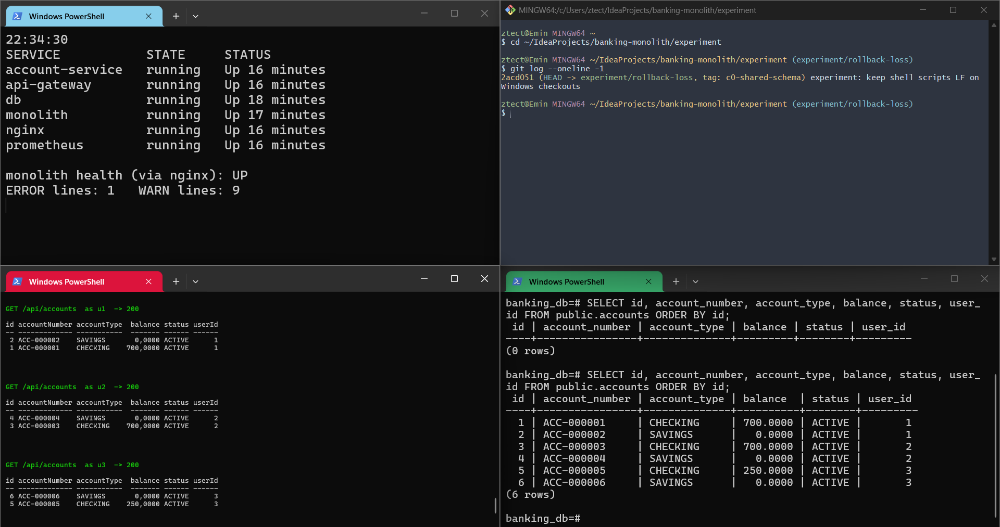
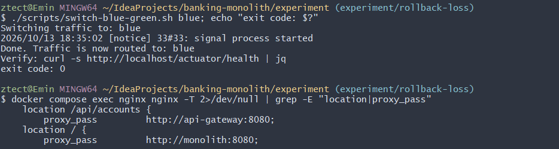
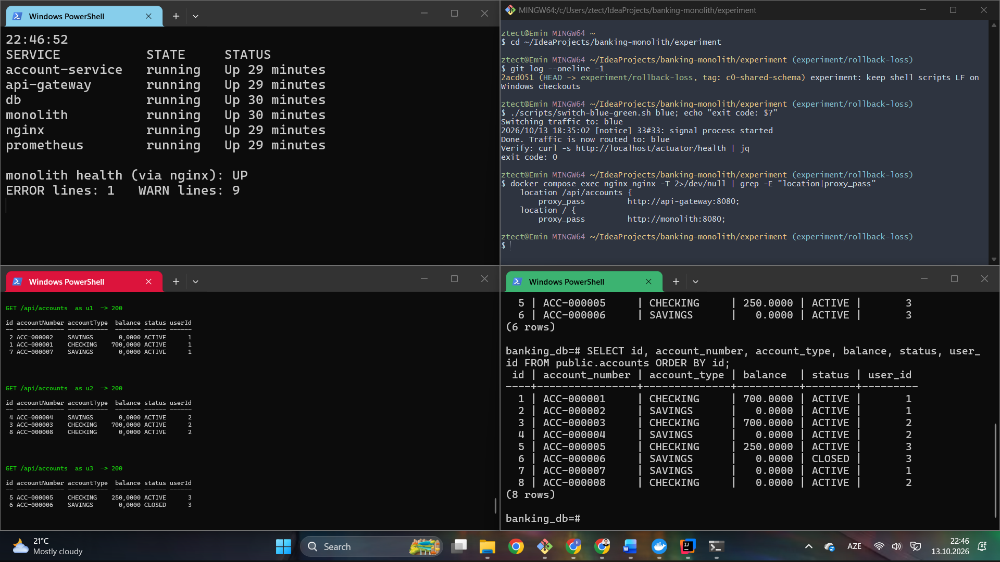
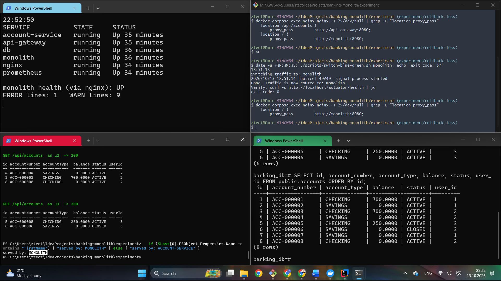
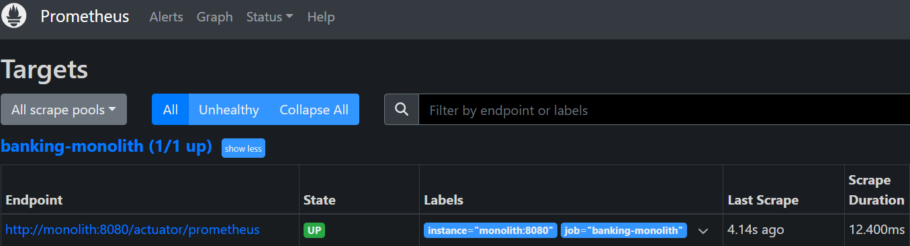

# Rollback-loss experiment

Does a blue-green rollback from an extracted microservice to the monolith silently
lose the writes made while traffic was on the microservice?

This directory measures that for one strangler step. The **account module** is
extracted into `account-service`, and Nginx switches `/api/accounts` between the
monolith and the service.

| Condition | Schema | Forward copy at cut-over | Service-era writes | Status |
|---|---|---|---|---|
| **C0** (control) | shared `public.accounts` | – | yes | **done**: 1 manual + 3 automated runs |
| C1a | separate `account_schema.accounts` | yes | no | pending |
| C1b | separate `account_schema.accounts` | yes | yes | pending |

C0 checks that the switching mechanism alone loses nothing. C1a checks whether schema
separation plus the forward copy loses anything on its own. C1b checks whether writes
made after the separation survive the rollback.

## This is a reconstruction

The thesis stage this experiment needs (monolith and services running side by side,
`nginx.monolith.conf`, schema-per-service) is not present in any commit of either
repository. It was rebuilt from the closest existing versions:

| Part | Source |
|---|---|
| Monolith | this repo @ `6c68e98`, the version that coexisted with the services. The later `d7d1d96` on `main` adds Flyway, `ddl-auto=validate` and a pessimistic lock; it is not used here. |
| `account-service`, `api-gateway` | [`banking-microservice`](https://github.com/EminHuseynli/banking-microservice) @ `4f077f2`, copied unchanged |
| `switch-blue-green.sh`, `init-schemas.sql` | `banking-microservice` @ `9929265` |

Changes made for the reconstruction:

1. **The monolith's JWT gets a `userId` claim** (`dfe41d8`). The gateway forwards it as
   `X-User-Id`; without it every account-service request fails with 400. The monolith
   itself never reads the claim. This is the only change to monolith code, and it is the
   same in every condition.
2. **Composition only**: a compose file, two Nginx configs, a Prometheus config, and the
   thesis switch script with a `monolith` target added.

Only the account module is extracted. Users, transactions and notifications stay in the
monolith, and the monolith's transaction module keeps writing `public.accounts`
directly. The service-era workload therefore uses only account endpoints (open, close,
list, balance); no money moves through the service.

## Code per condition

| Tag | Code |
|---|---|
| `c0-shared-schema` | account-service maps to `public.accounts`, the monolith's own table |
| `c1-schema-split` | adds the schema-separation parts of thesis §3.2 that apply to an account-only extraction: `init-schemas.sql` mounted into `docker-entrypoint-initdb.d`, `hibernate.default_schema: account_schema`, `@Table(schema = "account_schema")` |

`git diff c0-shared-schema c1-schema-split` is the whole difference: 4 files, 12 lines.
The thesis's fourth part (a Feign client in transaction-service) does not apply to an
account-only extraction.

## Procedure of one run

1. `docker compose down -v`, then start db → monolith → account-service, api-gateway,
   nginx, prometheus. The monolith starts first so that it creates the tables with its
   foreign keys.
2. **Seed via the monolith**: 3 users, 2 accounts each (`ACC-000001` … `ACC-000006`),
   three deposits, one withdrawal, one transfer.
3. **C1 only**: copy `public.accounts` into `account_schema.accounts` and advance the
   identity sequence (`sql/forward-copy.sql`).
4. `switch-blue-green.sh blue`. Re-login and read the accounts. The harness records which
   backend answered: the monolith's account response has `firstName`, the service's
   does not.
5. **Service-era workload** (C0, C1b): u1 opens account X, u2 opens account Y, u3 closes
   account Z (id 6).
6. `switch-blue-green.sh monolith`. Record the script output and exit code, the Nginx
   configuration actually loaded (`nginx -T`), and the database state.
7. **Verify via the monolith**:
   - Are X, Y and the closure of Z visible?
   - Can money still be deposited into Z?
   - u2 opens a new account: which number does it get?
   - u1 deposits into X using the id it received in the service era: whose account does
     the money land in?
8. Wait 300 s, then record monolith, gateway and service health, the Prometheus targets,
   monolith requests by HTTP status, and the ERROR/WARN log lines since the rollback.

Each condition is run **once manually** in a four-pane terminal (for screenshots) and
**three times automatically** with `run.sh` (for the numbers).

| Pane | Purpose |
|---|---|
| top left (PowerShell) | container state, monolith health via Nginx, ERROR/WARN counter |
| top right (Git Bash) | `switch-blue-green.sh`, `nginx -T` |
| bottom left (PowerShell) | client requests, with the HTTP status of every call |
| bottom right (psql) | the actual contents of the accounts table(s) |

## Results

### C0: shared schema (control)

| | Manual (1) | Automated (3) |
|---|---|---|
| Rollback script exit code | 0 | 0 / 0 / 0 |
| Monolith health, Prometheus target | UP, up | UP, up (3/3) |
| New ERROR / WARN lines after rollback | 0 / 0 | 0 / 0 in all four containers (3/3) |
| 5xx after rollback | 0 | 0 (3/3) |
| **Service-era writes visible after rollback** | **3/3** | **3/3** (3/3) |
| Deposit into the closed account | 400, rejected | 400 (3/3) |
| Monolith's next account number | `ACC-000009`, no reuse | `ACC-000009` (3/3) |
| Deposit by the service-era id of X | lands in u1's account | u1's account (3/3) |

**In 4 runs out of 4, every write made through account-service was still visible after
rolling back to the monolith, and all signals stayed green.** With a shared schema the
switch is safe in both directions, which is what the thesis describes for the first
phase of the Strangler Fig migration.

One observation that matters for C1: after its first request, the monolith writes **no
log lines at all**. It logs neither successful requests nor the rejected deposit (400).
`logs-monolith-after-rollback.txt` is empty. Whatever happens after a rollback, the logs
will not show it.

Manual run (13 Oct 2026, times in UTC; the terminal clocks show UTC+4):

| | |
|---|---|
| **Before the switch**: C0 code (`2acd051`), 6 containers up, health UP, baseline ERROR 1 / WARN 9 (startup warnings), 6 accounts |  |
| **Switch to blue** (18:35:02): exit code 0, Nginx sends `/api/accounts` to the gateway |  |
| **Service era**: X = 7, Y = 8, Z = 6 `CLOSED`; `public.accounts` has 8 rows |  |
| **After rollback** (18:51:13): exit code 0, Nginx sends everything to the monolith, `served by: MONOLITH`, all three writes visible, counters unchanged |  |
| **Prometheus** after rollback: `banking-monolith` 1/1 up |  |

Notes on the manual run:

- The screenshot of the `served by: ACCOUNT-SERVICE` check during the service era was
  lost while editing. That traffic reached the service is shown by `nginx -T`
  (screenshot 2) and by `forward_served_by: ["account-service"]` in every automated run.
- The four verification calls after the rollback (200 / 400 / 201 / 201) are not in a
  screenshot. Their effect is in `results/manual/C0-run1/db-final.txt`: 9 accounts,
  and transaction 6 "deposit by service-era id" on account 7.

### C1a, C1b

Pending.

## Files

```
experiment/
├── docker-compose.yml        one PostgreSQL, monolith, account-service, api-gateway, nginx, prometheus
├── nginx/                    nginx.monolith.conf, nginx.blue.conf (nginx.conf is generated)
├── scripts/switch-blue-green.sh
├── sql/forward-copy.sql      C1 cut-over copy (+ init-schemas.sql on c1-schema-split)
├── run.sh                    one automated run
├── harness/rollback.py       client and verifier (runs in a python:3.12-slim container)
└── results/
    ├── summary.md            one row per automated run
    ├── C0/run1..3/           http.jsonl (every request and response), summary.json,
    │                         meta.env, logs, DB snapshot, switch script output
    └── manual/C0-run1/       logs, db-final.txt, prometheus-targets.json, images/
```

## Reproduce

```bash
git checkout c0-shared-schema && for r in 1 2 3; do experiment/run.sh C0 $r; done
git checkout c1-schema-split  && for c in C1a C1b; do for r in 1 2 3; do experiment/run.sh $c $r; done; done
```

This needs Docker with Compose and bash (Git Bash on Windows). The harness runs in a
container, so nothing else is needed on the host. When running manually, rebuild the
images (`docker compose build`) after switching between the two tags.

## Limits

- One prototype, a synthetic workload, and only the account module.
- The experiment can show that the mechanism exists and whether it is silent. It says
  nothing about how common it is.
- It is a reconstruction, not the original thesis run.
