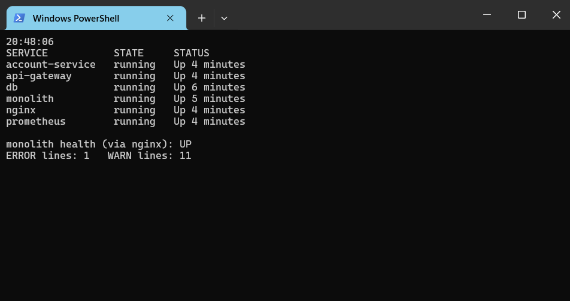
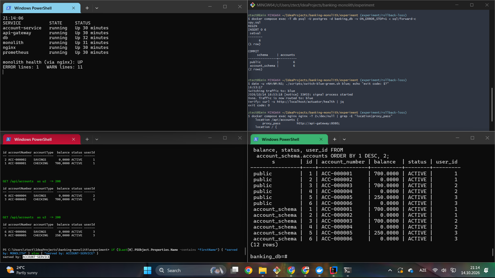
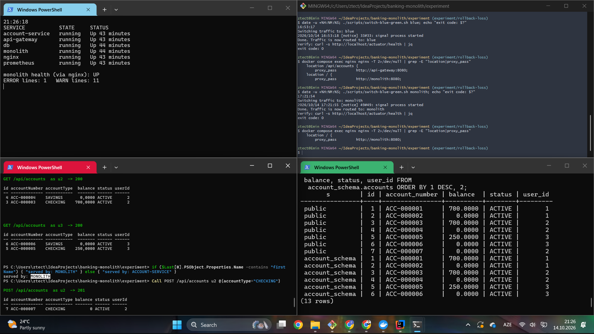
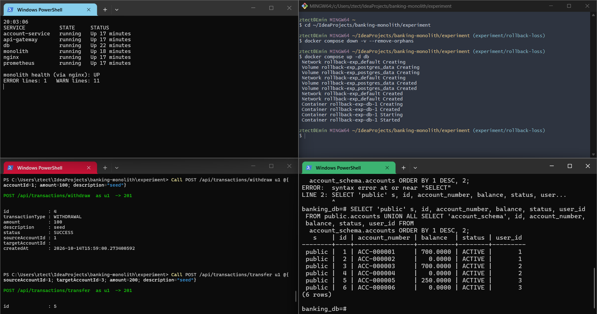
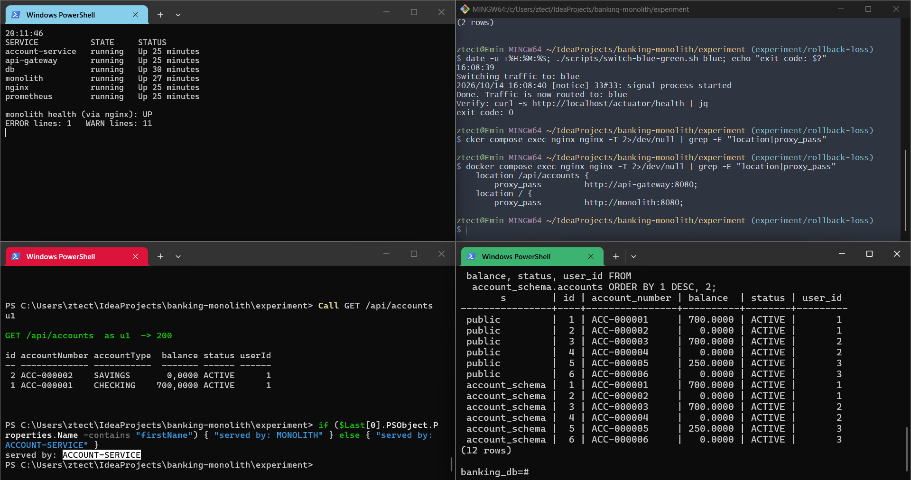
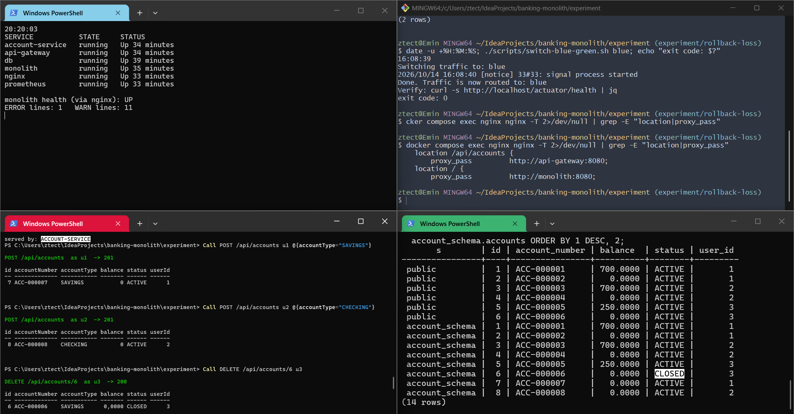
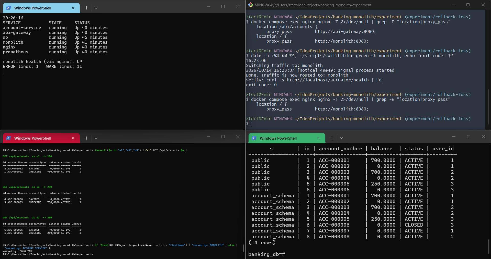
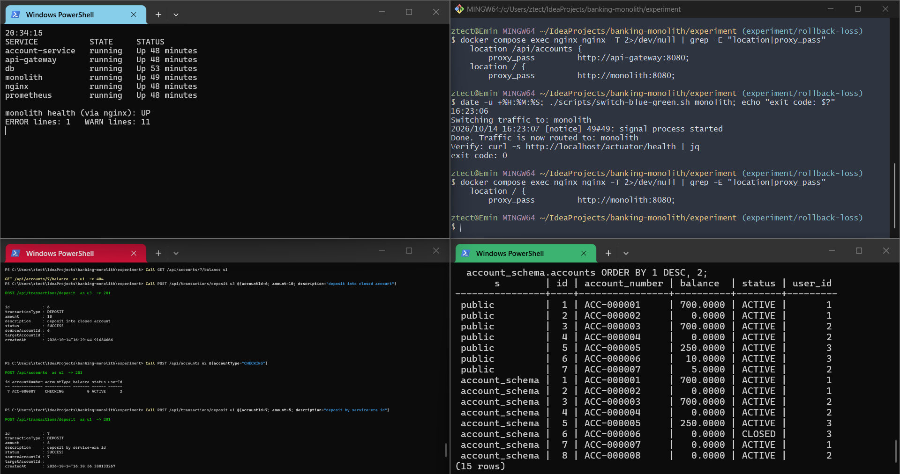
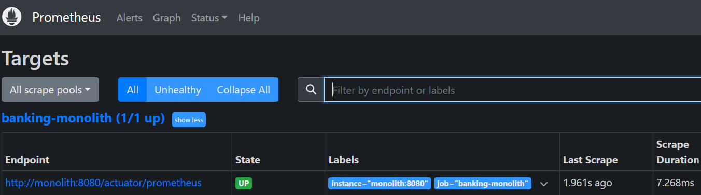

# Rollback-loss experiment

Does a blue-green rollback from an extracted microservice to the monolith silently
lose the writes made while traffic was on the microservice?

This directory measures that for one strangler step. The **account module** is
extracted into `account-service`, and Nginx switches `/api/accounts` between the
monolith and the service.

| Condition | Schema | Forward copy at cut-over | Service-era writes | Status |
|---|---|---|---|---|
| **C0** (control) | shared `public.accounts` | – | yes | **done**: 1 manual + 3 automated runs |
| C1a | separate `account_schema.accounts` | yes | no | **done**: 1 manual + 3 automated runs |
| C1b | separate `account_schema.accounts` | yes | yes | **done**: 1 manual + 3 automated runs |

C0 checks that the switching mechanism alone loses nothing. C1a checks whether schema
separation plus the forward copy loses anything on its own. C1b checks whether writes
made after the separation survive the rollback.

## This is a reconstruction

The thesis stage this experiment needs (monolith and services running side by side,
`nginx.monolith.conf`, schema-per-service) is not present in any commit of either
repository. It was rebuilt from the closest existing versions:

| Part | Source |
|---|---|
| Monolith | this repo @ `6c68e98`, the version that coexisted with the services. The later `d7d1d96` on `main` adds Flyway, `ddl-auto=validate` and a pessimistic lock; it is not used here. |
| `account-service`, `api-gateway` | [`banking-microservice`](https://github.com/EminHuseynli/banking-microservice) @ `4f077f2`, copied unchanged (comments translated later, see 3. below) |
| `switch-blue-green.sh`, `init-schemas.sql` | `banking-microservice` @ `9929265` |

Changes made for the reconstruction:

1. **The monolith's JWT gets a `userId` claim** (`dfe41d8`). The gateway forwards it as
   `X-User-Id`; without it every account-service request fails with 400. The monolith
   itself never reads the claim. This is the only functional change to monolith code, and
   it is the same in every condition.
2. **Composition only**: a compose file, two Nginx configs, a Prometheus config, and the
   thesis switch script with a `monolith` target added.
3. **Turkish text translated to English, after all runs**: three build comments in
   `services/api-gateway/Dockerfile` and the monolith's welcome notification
   ("Welcome! Your account has been successfully created.", the text `main` already
   uses). Neither touches the account code path. All runs used the code at the tags
   below (`c0-shared-schema`, `c1-schema-split`), which still carry the original text.

Only the account module is extracted. Users, transactions and notifications stay in the
monolith, and the monolith's transaction module keeps writing `public.accounts`
directly. The service-era workload therefore uses only account endpoints (open, close,
list, balance); no money moves through the service.

## Code per condition

| Tag | Code |
|---|---|
| `c0-shared-schema` | account-service maps to `public.accounts`, the monolith's own table |
| `c1-schema-split` | adds the schema-separation parts of thesis §3.2 that apply to an account-only extraction: `init-schemas.sql` mounted into `docker-entrypoint-initdb.d`, `hibernate.default_schema: account_schema`, `@Table(schema = "account_schema")` |

`git diff c0-shared-schema c1-schema-split` is the whole difference: 4 files, 12 lines.
The thesis's fourth part (a Feign client in transaction-service) does not apply to an
account-only extraction.

## Procedure of one run

1. `docker compose down -v`, then start db → monolith → account-service, api-gateway,
   nginx, prometheus. The monolith starts first so that it creates the tables with its
   foreign keys.
2. **Seed via the monolith**: 3 users, 2 accounts each (`ACC-000001` … `ACC-000006`),
   three deposits, one withdrawal, one transfer.
3. **C1 only**: copy `public.accounts` into `account_schema.accounts` and advance the
   identity sequence (`sql/forward-copy.sql`).
4. `switch-blue-green.sh blue`. Re-login and read the accounts. The harness records which
   backend answered: the monolith's account response has `firstName`, the service's
   does not.
5. **Service-era workload** (C0, C1b): u1 opens account X, u2 opens account Y, u3 closes
   account Z (id 6).
6. `switch-blue-green.sh monolith`. Record the script output and exit code, the Nginx
   configuration actually loaded (`nginx -T`), and the database state.
7. **Verify via the monolith**:
   - Are X, Y and the closure of Z visible?
   - Can money still be deposited into Z?
   - u2 opens a new account: which number does it get?
   - u1 deposits into X using the id it received in the service era: whose account does
     the money land in?
8. Wait 300 s, then record monolith, gateway and service health, the Prometheus targets,
   monolith requests by HTTP status, and the ERROR/WARN log lines since the rollback.

Each condition is run **once manually** in a four-pane terminal (for screenshots) and
**three times automatically** with `run.sh` (for the numbers).

| Pane | Purpose |
|---|---|
| top left (PowerShell) | container state, monolith health via Nginx, ERROR/WARN counter (`scripts/health-loop.ps1`) |
| top right (Git Bash) | `forward-copy.sql` (C1), `switch-blue-green.sh`, `nginx -T` |
| bottom left (PowerShell) | client requests, with the HTTP status of every call (`Call` / `Login` from `scripts/client.ps1`) |
| bottom right (psql) | the actual contents of the accounts table(s) |

In C1 the psql pane shows both tables side by side:

```sql
SELECT 'public' s, id, account_number, balance, status, user_id FROM public.accounts
UNION ALL
SELECT 'account_schema', id, account_number, balance, status, user_id FROM account_schema.accounts
ORDER BY 1 DESC, 2;
```

The C1 baseline of the ERROR/WARN counter is 1 / 11, all from startup. The one "ERROR"
is a Spring Security WARN line that ends in "...logging level ... to ERROR". C0 has
WARN 9; in C1 account-service creates its own table and logs two more "constraint ...
does not exist, skipping" warnings.

## Results

### C0: shared schema (control)

| | Manual (1) | Automated (3) |
|---|---|---|
| Rollback script exit code | 0 | 0 / 0 / 0 |
| Monolith health, Prometheus target | UP, up | UP, up (3/3) |
| New ERROR / WARN lines after rollback | 0 / 0 | 0 / 0 in all four containers (3/3) |
| 5xx after rollback | 0 | 0 (3/3) |
| **Service-era writes visible after rollback** | **3/3** | **3/3** (3/3) |
| Deposit into the closed account | 400, rejected | 400 (3/3) |
| Monolith's next account number | `ACC-000009`, no reuse | `ACC-000009` (3/3) |
| Deposit by the service-era id of X | lands in u1's account | u1's account (3/3) |

**In 4 runs out of 4, every write made through account-service was still visible after
rolling back to the monolith, and all signals stayed green.** With a shared schema the
switch is safe in both directions, which is what the thesis describes for the first
phase of the Strangler Fig migration.

One observation that matters for C1: after its first request, the monolith writes **no
log lines at all**. It logs neither successful requests nor the rejected deposit (400).
`logs-monolith-after-rollback.txt` is empty. Whatever happens after a rollback, the logs
will not show it.

Manual run (13 Oct 2026, times in UTC; the terminal clocks show UTC+4):

| | |
|---|---|
| **Before the switch**: C0 code (`2acd051`), 6 containers up, health UP, baseline ERROR 1 / WARN 9 (startup warnings), 6 accounts |  |
| **Switch to blue** (18:35:02): exit code 0, Nginx sends `/api/accounts` to the gateway |  |
| **Service era**: X = 7, Y = 8, Z = 6 `CLOSED`; `public.accounts` has 8 rows |  |
| **After rollback** (18:51:13): exit code 0, Nginx sends everything to the monolith, `served by: MONOLITH`, all three writes visible, counters unchanged |  |
| **Prometheus** after rollback: `banking-monolith` 1/1 up |  |

Notes on the manual run:

- The screenshot of the `served by: ACCOUNT-SERVICE` check during the service era was
  lost while editing. That traffic reached the service is shown by `nginx -T`
  (screenshot 2) and by `forward_served_by: ["account-service"]` in every automated run.
- The four verification calls after the rollback (200 / 400 / 201 / 201) are not in a
  screenshot. Their effect is in `results/manual/C0-run1/db-final.txt`: 9 accounts,
  and transaction 6 "deposit by service-era id" on account 7.

### C1a: separate schema, no service-era writes

| | Manual (1) | Automated (3) |
|---|---|---|
| Forward copy, switch to blue, rollback exit codes | 0, 0, 0 | 0, 0, 0 (3/3) |
| Traffic on the service during the service era | yes | yes (3/3) |
| Monolith health, Prometheus target | UP, up | UP, up (3/3) |
| New ERROR / WARN lines after rollback | 0 / 0 | 0 / 0 in all four containers (3/3) |
| 4xx / 5xx after rollback | 0 / 0 | 0 / 0 (3/3) |
| Seed accounts and balances after rollback | unchanged | unchanged (3/3) |
| Monolith's next account number | `ACC-000007`, nothing to clash with | `ACC-000007` (3/3) |
| Rows only in `account_schema` | 0 | 0 (3/3) |

**Separating the schema and copying the data at cut-over loses nothing on its own.**
Whatever goes wrong in C1b is caused by the writes made after the separation.

Manual run:

| | |
|---|---|
| **Clean start** (16:48 UTC): C1 code, 6 containers up, health UP, baseline ERROR 1 / WARN 11 |  |
| **Service era** (switch to blue at 16:53:17, exit 0): forward copy `INSERT 0 6`, Nginx sends `/api/accounts` to the gateway, `served by: ACCOUNT-SERVICE`, the same 6 accounts in both schemas (12 rows) |  |
| **After rollback** (17:21:54, exit 0): Nginx sends everything to the monolith, `served by: MONOLITH`, all accounts unchanged, u2's new account is `ACC-000007` (201); `public` 7 rows, `account_schema` 6 rows, counters unchanged |  |

More screenshots are in `results/manual/C1a-run1/images/detail/`. The Prometheus
screenshot there (`prometheus-tab-not-refreshed.png`) shows exactly the same values as
the C1b one (`1.961s ago`): the browser tab was not reloaded, so it is not evidence for
this run. The target state after this rollback comes from the Prometheus API
(`prometheus-targets.json`, captured 17:28 UTC: `banking-monolith` up).

### C1b: separate schema, service-era writes

| | Manual (1) | Automated (3) |
|---|---|---|
| Forward copy, switch to blue, rollback exit codes | 0, 0, 0 | 0, 0, 0 (3/3) |
| Monolith health, Prometheus target | UP, up | UP, up (3/3) |
| New ERROR / WARN lines after rollback | 0 / 0 | 0 / 0 in all four containers (3/3) |
| 5xx after rollback | 0 | 0 (3/3) |
| **Service-era writes visible after rollback** | **0/3** | **0/3** (3/3) |
| Balance of X by its service-era id | 404 | 404 (3/3) |
| Deposit into the closed account Z | **201, accepted** | 201 (3/3) |
| Monolith's next account number | **`ACC-000007`, X's number, given to u2** | same (3/3) |
| Deposit by the service-era id of X | **201, lands in u2's account** | u2's account (3/3) |
| Rows only in `account_schema` / status differs | 2 (X, Y) / 1 (Z) | 2 / 1 (3/3) |

**In 4 runs out of 4, every write made through account-service was missing after the
rollback, and every signal stayed green.** The rollback script, health, Prometheus,
HTTP status codes and logs all report a healthy system. The only trace is one 404 on
X's balance, which looks like any other "not found".

What the loss leads to:

- **A closed account comes back.** Z's closure exists only in `account_schema`; the
  monolith sees Z as `ACTIVE` and takes money into it.
- **Ids and account numbers are handed out twice.** The `public` sequence is still at 6,
  so the monolith gives u2 id 7 and `ACC-000007`, which the service had already given to
  u1's X.
- **Money goes to the wrong customer.** The monolith's deposit does not check who owns
  the account. u1 deposits into id 7, the id it got from the service, gets 201, and the
  money lands in u2's new account.

The writes are not destroyed: they are still in `account_schema.accounts`. The monolith
never reads that table, and the rollback only switches traffic; nothing copies data back.

Manual run (14 Oct 2026, times in UTC; the terminal clocks show UTC+4):

| | |
|---|---|
| **Seeded, before the forward copy**: 6 containers up, health UP, ERROR 1 / WARN 11; `public.accounts` 6 rows (the syntax error above the table is a mis-pasted query, re-run below it) |  |
| **Forward copy and switch to blue** (16:08:39, exit 0): Nginx sends `/api/accounts` to the gateway, `served by: ACCOUNT-SERVICE`, both schemas hold the same 6 accounts (12 rows) |  |
| **Service era**: X = 7, Y = 8, Z = 6 `CLOSED`, all through account-service. `account_schema` has 8 rows and Z `CLOSED`; `public` still has 6 rows and Z `ACTIVE`. Counters unchanged |  |
| **After rollback** (16:23:06, exit 0): `served by: MONOLITH`, every call 200, X and Y gone, Z `ACTIVE` again; health UP, counters unchanged |  |
| **Consequences**: X's balance 404; deposit into closed Z 201; u2's new account `ACC-000007`; u1's deposit by id 7 201. `public` now has Z with 10.0000 and id 7 (u2) with 5.0000 |  |
| **Prometheus** after rollback: `banking-monolith` 1/1 up |  |

Close-ups of the bottom-left pane (seed requests, service-era writes, the views after
rollback, the four consequence calls) are in `results/manual/C1b-run1/images/detail/`.
After the rollback the monolith, account-service and gateway wrote no log lines at all
(`logs-monolith-after-rollback.txt` is empty); Nginx logged 192× 200, 3× 201 and 1× 404.
`db-final.txt` holds both account tables and the transactions: transaction 6 went into
closed account 6, transaction 7 into u2's account 7.

### All conditions

| | C0 | C1a | C1b |
|---|---|---|---|
| Runs (manual + automated) | 1 + 3 | 1 + 3 | 1 + 3 |
| Rollback exit code, health, Prometheus | 0, UP, up | 0, UP, up | 0, UP, up |
| New ERROR / WARN, 5xx after rollback | 0 | 0 | 0 |
| **Service-era writes visible** | **3/3** | – (none made) | **0/3** |
| Deposit into the closed account | 400, rejected | – | **201, accepted** |
| Monolith's next account number | `ACC-000009` | `ACC-000007` | **`ACC-000007`, reused** |
| Deposit by a service-era id | lands with its owner | – | **lands with another customer** |

C0 shows that the switching mechanism loses nothing; C1a shows that the schema
separation and the forward copy lose nothing. In C1b the only difference is writes made
after the separation, and all of them are lost silently. The signals used to decide
whether a rollback worked (exit code, health, Prometheus, status codes, logs) measure
whether the system is up, not whether its data is complete.

## Files

```
experiment/
├── docker-compose.yml        one PostgreSQL, monolith, account-service, api-gateway, nginx, prometheus
├── nginx/                    nginx.monolith.conf, nginx.blue.conf (nginx.conf is generated)
├── scripts/
│   ├── switch-blue-green.sh
│   ├── health-loop.ps1       manual runs: top-left pane
│   └── client.ps1            manual runs: Call / Login helpers for the bottom-left pane
├── sql/forward-copy.sql      C1 cut-over copy (+ init-schemas.sql on c1-schema-split)
├── run.sh                    one automated run
├── harness/rollback.py       client and verifier (runs in a python:3.12-slim container)
└── results/
    ├── summary.md            one row per automated run
    ├── C0/ C1a/ C1b/run1..3/ http.jsonl (every request and response), summary.json,
    │                         meta.env, logs, DB snapshot, switch script output
    └── manual/
        ├── C0-run1/          logs, db-final.txt, prometheus-targets.json, images/
        └── C1a-run1/ C1b-run1/  the same, plus nginx-after-rollback.conf,
                              prometheus-requests-by-status.json, images/detail/
```

## Reproduce

```bash
git checkout c0-shared-schema && for r in 1 2 3; do experiment/run.sh C0 $r; done
git checkout c1-schema-split  && for c in C1a C1b; do for r in 1 2 3; do experiment/run.sh $c $r; done; done
```

This needs Docker with Compose and bash (Git Bash on Windows). The harness runs in a
container, so nothing else is needed on the host. When running manually, rebuild the
images (`docker compose build`) after switching between the two tags.

## Limits

- One prototype, a synthetic workload, and only the account module.
- The experiment can show that the mechanism exists and whether it is silent. It says
  nothing about how common it is.
- It is a reconstruction, not the original thesis run.
