# Rollback-loss experiment

Does a blue-green rollback from an extracted microservice to the monolith silently
lose the writes made while traffic was on the microservice?

This directory measures that for two strangler steps. In C0 and C1 the **account
module** is extracted into `account-service`, and Nginx switches `/api/accounts` between
the monolith and the service. In C2 the **transaction module** is extracted as well
(`transaction-service`, which moves money through account-service over Feign), and
Nginx also switches `/api/transactions`.

| Condition | Extracted | Schema | Forward copy at cut-over | Service-era writes | Rolled back | Status |
|---|---|---|---|---|---|---|
| **C0** (control) | accounts | shared `public` | – | accounts | everything | **done**: 1 manual + 3 automated runs |
| C1a | accounts | `account_schema` | yes | none | everything | **done**: 1 manual + 3 automated runs |
| C1b | accounts | `account_schema` | yes | accounts | everything | **done**: 1 manual + 3 automated runs |
| **C2a** | accounts, transactions | `account_schema`, `transaction_schema` | yes | accounts and money | everything | **done**: 1 manual + 3 automated runs |
| **C2b** | accounts, transactions | `account_schema`, `transaction_schema` | yes | accounts and money | only `/api/transactions` | **done**: 1 manual + 3 automated runs |

C0 checks that the switching mechanism alone loses nothing. C1a checks whether schema
separation plus the forward copy loses anything on its own. C1b checks whether writes
made after the separation survive the rollback. C2a asks the same with money moving
through the services. C2b rolls back only one of the two services, so the monolith and
a service answer at the same time on the same data.

C2 has no no-write condition like C1a. Instead, every C2 run checks right after the
forward copy that each account and transaction row arrived unchanged
(`fwd_accounts_missing`, `fwd_transactions_missing` in `meta.env`); all were 0.

## This is a reconstruction

The thesis stage this experiment needs (monolith and services running side by side,
`nginx.monolith.conf`, schema-per-service) is not present in any commit of either
repository. It was rebuilt from the closest existing versions:

| Part | Source |
|---|---|
| Monolith | this repo @ `6c68e98`, the version that coexisted with the services. The later `d7d1d96` on `main` adds Flyway, `ddl-auto=validate` and a pessimistic lock; it is not used here. |
| `account-service`, `api-gateway` | [`banking-microservice`](https://github.com/EminHuseynli/banking-microservice) @ `4f077f2`, copied unchanged (comments translated later, see 3. below) |
| `transaction-service` (C2) | `banking-microservice` @ `4f077f2`, copied unchanged in `2f1eff3` (`diff -r` clean, original Turkish comments kept) |
| `switch-blue-green.sh`, `init-schemas.sql` | `banking-microservice` @ `9929265` |

Changes made for the reconstruction:

1. **The monolith's JWT gets a `userId` claim** (`dfe41d8`). The gateway forwards it as
   `X-User-Id`; without it every account-service request fails with 400. The monolith
   itself never reads the claim. This is the only functional change to monolith code, and
   it is the same in every condition.
2. **Composition only**: a compose file, Nginx configs, a Prometheus config, and the
   thesis switch script with a `monolith` target added. C2 adds transaction-service and
   `rabbitmq:3-management` (the thesis image) to the compose file, routes
   `/api/transactions` in `nginx.blue.conf`, and adds `nginx.partial.conf` plus a
   `partial` switch target for C2b.
3. **Turkish text translated to English, after all runs**: three build comments in
   `services/api-gateway/Dockerfile` and the monolith's welcome notification
   ("Welcome! Your account has been successfully created.", the text `main` already
   uses). Neither touches the account code path. All runs used the code at the tags
   below (`c0-shared-schema`, `c1-schema-split`), which still carry the original text.

In C0 and C1 only the account module is extracted. Users, transactions and notifications
stay in the monolith, and the monolith's transaction module keeps writing
`public.accounts` directly. The service-era workload therefore uses only account
endpoints (open, close, list, balance); no money moves through the service.

In C2 the transaction module is extracted too; users and notifications stay in the
monolith. transaction-service (4f077f2) publishes a notification event to RabbitMQ after
every transaction. notification-service is not extracted, so **nothing consumes that
queue**: service-era notifications never reach users in any C2 run. This is a property
of extracting transaction-service without notification-service, not of the rollback;
it is reported separately below.

## Code per condition

| Tag | Code |
|---|---|
| `c0-shared-schema` | account-service maps to `public.accounts`, the monolith's own table |
| `c1-schema-split` | adds the schema-separation parts of thesis §3.2 that apply to an account-only extraction: `init-schemas.sql` mounted into `docker-entrypoint-initdb.d`, `hibernate.default_schema: account_schema`, `@Table(schema = "account_schema")` |

| `c2-transaction-split` | C1 code plus transaction-service: the copy of 4f077f2 (`2f1eff3`), then the same two schema-separation lines for it (`147e80b`): `hibernate.default_schema: transaction_schema`, `@Table(schema = "transaction_schema")`. Its Feign client to account-service's internal API (thesis §3.2, part four) is used as it is. |

`git diff c0-shared-schema c1-schema-split` is the whole C1 difference: 4 files, 12
lines. `git diff 2f1eff3 147e80b -- services` is the whole change to thesis code in C2:
2 files, 2 lines. The thesis's fourth part (a Feign client in transaction-service) does
not apply to the account-only extraction of C1; it is part of C2.

The C2 manual runs used the tag (`c4010a5`). The C2 automated runs used `d1291a2`, whose
application code is the same; it adds 6 lines to `run.sh` and the harness that count the
transaction ids the monolith reuses (`19100c2`), a finding of the manual C2a run.

## Procedure of one run

1. `docker compose down -v`, then start db → monolith → account-service, api-gateway,
   nginx, prometheus (C2: also rabbitmq and transaction-service). The monolith starts
   first so that it creates the tables with its foreign keys.
2. **Seed via the monolith**: 3 users, 2 accounts each (`ACC-000001` … `ACC-000006`),
   three deposits, one withdrawal, one transfer (transactions 1–5; balances 700 / 700 /
   250).
3. **C1 and C2**: copy `public.accounts` into `account_schema.accounts` and advance the
   identity sequence (`sql/forward-copy.sql`). C2 also copies `public.transactions` into
   `transaction_schema.transactions` (`-v c2=1`) and checks that no row was lost.
4. `switch-blue-green.sh blue`. Re-login and read the accounts. The harness records which
   backend answered: the monolith's account response has `firstName`, the service's
   does not.
5. **Service-era workload** (C0, C1b, C2): u1 opens account X, u2 opens account Y, u3
   closes account Z (id 6). **C2 adds money moves** through transaction-service →
   Feign → account-service: deposit 300 into u1's account 1, u2 withdraws 100 from
   account 3, transfer 150 from account 1 to u3's account 5, deposit 50 into X
   (transactions 6–9). Balances at the end of the service era: 850 / 600 / 400, X 50.
6. Roll back: `switch-blue-green.sh monolith` (C2b: `switch-blue-green.sh partial`, only
   `/api/transactions` goes back). Record the script output and exit code, the Nginx
   configuration actually loaded (`nginx -T`), the database state, and (C2) the RabbitMQ
   queue depth.
7. **Verify via the monolith** (C0, C1, C2a):
   - Are X, Y and the closure of Z visible?
   - Can money still be deposited into Z?
   - u2 opens a new account: which number does it get?
   - u1 deposits into X using the id it received in the service era: whose account does
     the money land in?
   - C2a: are the service-era balances and transactions visible? u2 withdraws everything
     the monolith shows for account 3: is that more than the account held?

   **C2b** (accounts still on account-service, money on the monolith):
   - What does the account view show? Does the transaction history agree with it?
   - u1 deposits 20 into account 1 through the monolith: does the account view change?
   - u1 deposits into X, which the account view lists. u3 deposits into Z, which the
     account view shows as `CLOSED`.
   - u2 withdraws 50 more than the account view shows for account 3.
8. Wait 300 s, then record monolith, gateway and service health, the Prometheus targets,
   monolith requests by HTTP status, and the ERROR/WARN log lines since the rollback.
   C2 also counts transaction ids that now mean different transactions in the two
   schemas.

Each condition is run **once manually** in a four-pane terminal (for screenshots) and
**three times automatically** with `run.sh` (for the numbers).

| Pane | Purpose |
|---|---|
| top left (PowerShell) | container state, monolith health via Nginx, ERROR/WARN counter, in C2 also the RabbitMQ queue depth (`scripts/health-loop.ps1`) |
| top right (Git Bash) | `forward-copy.sql` (C1, C2), `switch-blue-green.sh`, `nginx -T` |
| bottom left (PowerShell) | client requests, with the HTTP status of every call (`Call` / `Login` from `scripts/client.ps1`) |
| bottom right (psql) | the actual contents of the accounts table(s) |

In C1 the psql pane shows both tables side by side:

```sql
SELECT 'public' s, id, account_number, balance, status, user_id FROM public.accounts
UNION ALL
SELECT 'account_schema', id, account_number, balance, status, user_id FROM account_schema.accounts
ORDER BY 1 DESC, 2;
```

The C1 baseline of the ERROR/WARN counter is 1 / 11, all from startup. The one "ERROR"
is a Spring Security WARN line that ends in "...logging level ... to ERROR". C0 has
WARN 9; in C1 account-service creates its own table and logs two more "constraint ...
does not exist, skipping" warnings. The C2 baseline is 1 / 13: transaction-service adds
two startup warnings (`spring.jpa.open-in-view`, the dialect deprecation notice).

In C2 the psql pane compares the two sides at the rollback:

```sql
SELECT s.id, p.balance AS public_bal, s.balance AS service_bal, p.status AS public_st, s.status AS service_st
FROM account_schema.accounts s LEFT JOIN public.accounts p ON p.id = s.id ORDER BY s.id;
SELECT (SELECT sum(balance) FROM public.accounts) AS public_sum,
       (SELECT sum(balance) FROM account_schema.accounts) AS service_sum;
SELECT id, transaction_type, amount, source_account_id, target_account_id
FROM transaction_schema.transactions WHERE id NOT IN (SELECT id FROM public.transactions) ORDER BY id;
```

## Results

### C0: shared schema (control)

| | Manual (1) | Automated (3) |
|---|---|---|
| Rollback script exit code | 0 | 0 / 0 / 0 |
| Monolith health, Prometheus target | UP, up | UP, up (3/3) |
| New ERROR / WARN lines after rollback | 0 / 0 | 0 / 0 in all four containers (3/3) |
| 5xx after rollback | 0 | 0 (3/3) |
| **Service-era writes visible after rollback** | **3/3** | **3/3** (3/3) |
| Deposit into the closed account | 400, rejected | 400 (3/3) |
| Monolith's next account number | `ACC-000009`, no reuse | `ACC-000009` (3/3) |
| Deposit by the service-era id of X | lands in u1's account | u1's account (3/3) |

**In 4 runs out of 4, every write made through account-service was still visible after
rolling back to the monolith, and all signals stayed green.** With a shared schema the
switch is safe in both directions, which is what the thesis describes for the first
phase of the Strangler Fig migration.

One observation that matters for C1: after its first request, the monolith writes **no
log lines at all**. It logs neither successful requests nor the rejected deposit (400).
`logs-monolith-after-rollback.txt` is empty. Whatever happens after a rollback, the logs
will not show it.

Manual run (13 Oct 2026, times in UTC; the terminal clocks show UTC+4):

| | |
|---|---|
| **Before the switch**: C0 code (`2acd051`), 6 containers up, health UP, baseline ERROR 1 / WARN 9 (startup warnings), 6 accounts |  |
| **Switch to blue** (18:35:02): exit code 0, Nginx sends `/api/accounts` to the gateway |  |
| **Service era**: X = 7, Y = 8, Z = 6 `CLOSED`; `public.accounts` has 8 rows |  |
| **After rollback** (18:51:13): exit code 0, Nginx sends everything to the monolith, `served by: MONOLITH`, all three writes visible, counters unchanged |  |
| **Prometheus** after rollback: `banking-monolith` 1/1 up |  |

Notes on the manual run:

- The screenshot of the `served by: ACCOUNT-SERVICE` check during the service era was
  lost while editing. That traffic reached the service is shown by `nginx -T`
  (screenshot 2) and by `forward_served_by: ["account-service"]` in every automated run.
- The four verification calls after the rollback (200 / 400 / 201 / 201) are not in a
  screenshot. Their effect is in `results/manual/C0-run1/db-final.txt`: 9 accounts,
  and transaction 6 "deposit by service-era id" on account 7.

### C1a: separate schema, no service-era writes

| | Manual (1) | Automated (3) |
|---|---|---|
| Forward copy, switch to blue, rollback exit codes | 0, 0, 0 | 0, 0, 0 (3/3) |
| Traffic on the service during the service era | yes | yes (3/3) |
| Monolith health, Prometheus target | UP, up | UP, up (3/3) |
| New ERROR / WARN lines after rollback | 0 / 0 | 0 / 0 in all four containers (3/3) |
| 4xx / 5xx after rollback | 0 / 0 | 0 / 0 (3/3) |
| Seed accounts and balances after rollback | unchanged | unchanged (3/3) |
| Monolith's next account number | `ACC-000007`, nothing to clash with | `ACC-000007` (3/3) |
| Rows only in `account_schema` | 0 | 0 (3/3) |

**Separating the schema and copying the data at cut-over loses nothing on its own.**
Whatever goes wrong in C1b is caused by the writes made after the separation.

Manual run:

| | |
|---|---|
| **Clean start** (16:48 UTC): C1 code, 6 containers up, health UP, baseline ERROR 1 / WARN 11 |  |
| **Service era** (switch to blue at 16:53:17, exit 0): forward copy `INSERT 0 6`, Nginx sends `/api/accounts` to the gateway, `served by: ACCOUNT-SERVICE`, the same 6 accounts in both schemas (12 rows) |  |
| **After rollback** (17:21:54, exit 0): Nginx sends everything to the monolith, `served by: MONOLITH`, all accounts unchanged, u2's new account is `ACC-000007` (201); `public` 7 rows, `account_schema` 6 rows, counters unchanged |  |

More screenshots are in `results/manual/C1a-run1/images/detail/`. The Prometheus
screenshot there (`prometheus-tab-not-refreshed.png`) shows exactly the same values as
the C1b one (`1.961s ago`): the browser tab was not reloaded, so it is not evidence for
this run. The target state after this rollback comes from the Prometheus API
(`prometheus-targets.json`, captured 17:28 UTC: `banking-monolith` up).

### C1b: separate schema, service-era writes

| | Manual (1) | Automated (3) |
|---|---|---|
| Forward copy, switch to blue, rollback exit codes | 0, 0, 0 | 0, 0, 0 (3/3) |
| Monolith health, Prometheus target | UP, up | UP, up (3/3) |
| New ERROR / WARN lines after rollback | 0 / 0 | 0 / 0 in all four containers (3/3) |
| 5xx after rollback | 0 | 0 (3/3) |
| **Service-era writes visible after rollback** | **0/3** | **0/3** (3/3) |
| Balance of X by its service-era id | 404 | 404 (3/3) |
| Deposit into the closed account Z | **201, accepted** | 201 (3/3) |
| Monolith's next account number | **`ACC-000007`, X's number, given to u2** | same (3/3) |
| Deposit by the service-era id of X | **201, lands in u2's account** | u2's account (3/3) |
| Rows only in `account_schema` / status differs | 2 (X, Y) / 1 (Z) | 2 / 1 (3/3) |

**In 4 runs out of 4, every write made through account-service was missing after the
rollback, and every signal stayed green.** The rollback script, health, Prometheus,
HTTP status codes and logs all report a healthy system. The only trace is one 404 on
X's balance, which looks like any other "not found".

What the loss leads to:

- **A closed account comes back.** Z's closure exists only in `account_schema`; the
  monolith sees Z as `ACTIVE` and takes money into it.
- **Ids and account numbers are handed out twice.** The `public` sequence is still at 6,
  so the monolith gives u2 id 7 and `ACC-000007`, which the service had already given to
  u1's X.
- **Money goes to the wrong customer.** The monolith's deposit does not check who owns
  the account. u1 deposits into id 7, the id it got from the service, gets 201, and the
  money lands in u2's new account.

The writes are not destroyed: they are still in `account_schema.accounts`. The monolith
never reads that table, and the rollback only switches traffic; nothing copies data back.

Manual run (14 Oct 2026, times in UTC; the terminal clocks show UTC+4):

| | |
|---|---|
| **Seeded, before the forward copy**: 6 containers up, health UP, ERROR 1 / WARN 11; `public.accounts` 6 rows (the syntax error above the table is a mis-pasted query, re-run below it) |  |
| **Forward copy and switch to blue** (16:08:39, exit 0): Nginx sends `/api/accounts` to the gateway, `served by: ACCOUNT-SERVICE`, both schemas hold the same 6 accounts (12 rows) |  |
| **Service era**: X = 7, Y = 8, Z = 6 `CLOSED`, all through account-service. `account_schema` has 8 rows and Z `CLOSED`; `public` still has 6 rows and Z `ACTIVE`. Counters unchanged |  |
| **After rollback** (16:23:06, exit 0): `served by: MONOLITH`, every call 200, X and Y gone, Z `ACTIVE` again; health UP, counters unchanged |  |
| **Consequences**: X's balance 404; deposit into closed Z 201; u2's new account `ACC-000007`; u1's deposit by id 7 201. `public` now has Z with 10.0000 and id 7 (u2) with 5.0000 |  |
| **Prometheus** after rollback: `banking-monolith` 1/1 up |  |

Close-ups of the bottom-left pane (seed requests, service-era writes, the views after
rollback, the four consequence calls) are in `results/manual/C1b-run1/images/detail/`.
After the rollback the monolith, account-service and gateway wrote no log lines at all
(`logs-monolith-after-rollback.txt` is empty); Nginx logged 192× 200, 3× 201 and 1× 404.
`db-final.txt` holds both account tables and the transactions: transaction 6 went into
closed account 6, transaction 7 into u2's account 7.

### C2a: accounts and transactions extracted, money moves, full rollback

| | Manual (1) | Automated (3) |
|---|---|---|
| Forward copy: rows lost | 0 accounts, 0 transactions | 0, 0 (3/3) |
| Forward copy, switch to blue, rollback exit codes | 0, 0, 0 | 0, 0, 0 (3/3) |
| Monolith health, Prometheus target | UP, up | UP, up (3/3) |
| New ERROR / WARN lines after rollback | 0 / 0 | 0 / 0 in all six containers (3/3) |
| 5xx after rollback | 0 | 0 (3/3) |
| **Service-era account writes visible** | **0/3** | **0/3** (3/3) |
| **Service-era transactions on account 1 visible** | **0/2** | **0/2** (3/3) |
| **Balances the monolith shows wrongly** | **3** (700 / 700 / 250 instead of 850 / 600 / 400), 400 in total | 3, 400 (3/3) |
| Balance of X by its service-era id | 404 | 404 (3/3) |
| Deposit into the closed account Z | 201, accepted | 201 (3/3) |
| Monolith's next account number, deposit by X's old id | `ACC-000007` to u2, u1's money lands with u2 | same (3/3) |
| **u2 withdraws all the monolith shows for account 3** | **201: 700 withdrawn from an account that held 600** | **+100 (3/3)** |
| Transaction ids reused for different transactions | 6, 7, 8 | 3 (3/3) |
| Rows only in `account_schema` / `transaction_schema` | 2 / 4 | 2 / 4 (3/3) |
| Sum of balances, `public` vs `account_schema`, at rollback | 1650 vs 1900 | same (3/3) |
| Service-era notifications delivered / left in the queue | 0 / 5 | 0 / 5 (3/3) |

**With money moving through the services, the rollback loses money, not only rows.**
Everything C1b showed happens again. On top of it, the monolith shows every balance as it
was before the service era, so u2 can withdraw the 100 it had already withdrawn through
the service a second time. The monolith's transaction sequence is still at 5, so it hands
out ids 6, 7 and 8 again; in `transaction_schema` those ids are different transactions
(a deposit of 300, a withdrawal of 100, a transfer of 150). Every signal stays green.

Manual run (15 Oct 2026, times in UTC; the terminal clocks show UTC+4). All 22
screenshots, each described, are in [`results/manual/C2a-run1/`](results/manual/C2a-run1/README.md).

| | |
|---|---|
| **Forward copy** (~08:33): 6 accounts and 5 transactions copied; the copied rows (bottom right) equal the monolith's view (bottom left) | 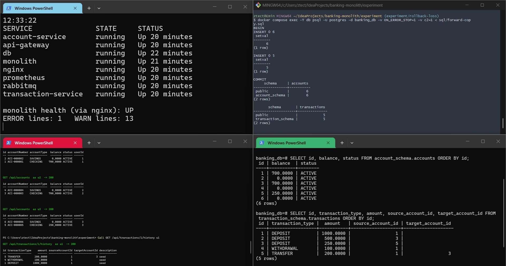 |
| **Service era, money moves** (08:45): transactions 6–9 through transaction-service, all 201 | 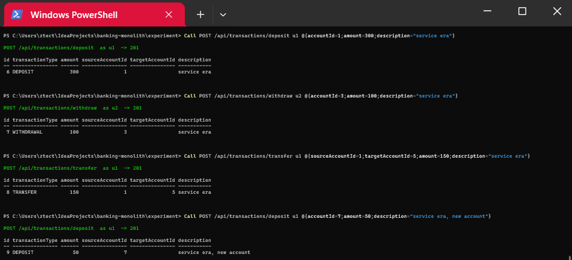 |
| **End of the service era** (08:59, before the rollback): health UP, 1 / 13, 5 notification events nobody consumes | 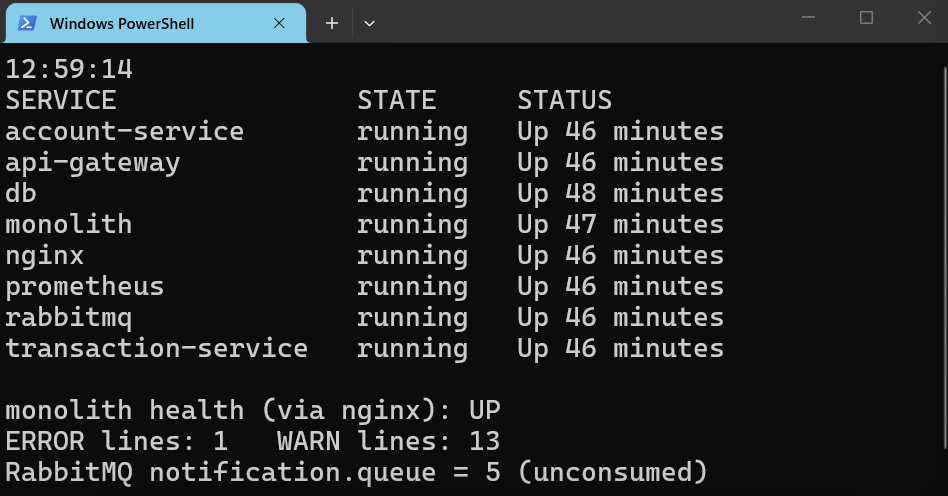 |
| **Database at the rollback** (09:00:33): balances differ on accounts 1, 3, 5; Z `ACTIVE` vs `CLOSED`; X and Y only in `account_schema`; 1650 vs 1900; transactions 6–9 only in `transaction_schema` | 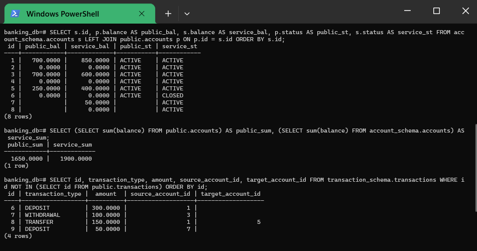 |
| **After the rollback**: users see 700 / 700 / 250, no X, no Y, Z `ACTIVE`; the monolith answers (`firstName` U3) | 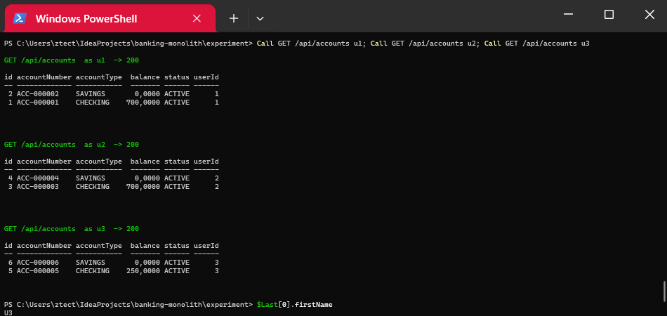 |
| **Consequences**: history of account 1 lost transactions 6 and 8; X's balance 404; deposit into closed Z 201 with transaction id 6 | 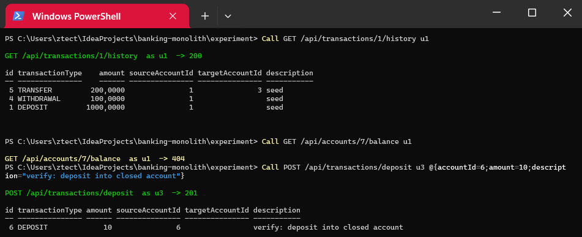 |
| **More consequences**: `ACC-000007` to u2, u1's deposit by id 7 lands with u2, **u2 withdraws 700 from an account that held 600** | 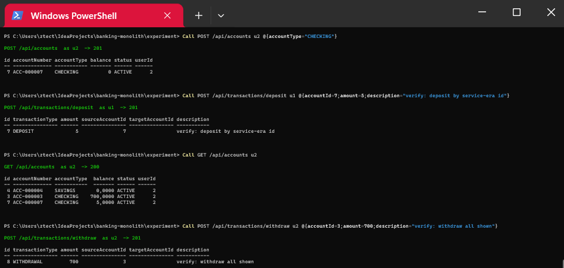 |

Notes on the manual run:

- After the rollback the monolith wrote no log line (`logs-monolith-after-rollback.txt`
  is empty), and the queue still held 5 events at the end (`db-final.txt`).
- Prometheus shows one 403 on the monolith. It is `POST /get_message_for_webview` from a
  browser extension (Grammarly) that hit `localhost` at 09:09:54 (nginx: 499,
  Prometheus: `uri="UNKNOWN"`, see `prometheus-4xx-detail.json`). It is not part of the
  experiment. None of the automated runs has it.
- The screenshot times were first read as UTC+3, which put the queue screenshot after the
  rollback. Container uptimes show UTC+4; it was taken just before the rollback. Fixed in
  `0c4b260`.

### C2b: accounts and transactions extracted, money moves, only transactions rolled back

| | Manual (1) | Automated (3) |
|---|---|---|
| Forward copy: rows lost | 0 accounts, 0 transactions | 0, 0 (3/3) |
| Forward copy, switch to blue, partial rollback exit codes | 0, 0, 0 | 0, 0, 0 (3/3) |
| Routes to the gateway after the rollback (`nginx -T`) | `/api/accounts` only | same (3/3) |
| Health of monolith, gateway, both services; Prometheus target | UP, up | UP, up (3/3) |
| New ERROR / WARN lines after rollback | 0 / 0 | 0 / 0 in all six containers (3/3) |
| 5xx after rollback | 0 | 0 (3/3) |
| Account view (still account-service) | service-era state: 850 / 600 / 400, X 50, Z `CLOSED` | same (3/3) |
| Service-era transactions on account 1 in the history (now the monolith) | 0/2 | 0/2 (3/3) |
| **Deposit of 20 into account 1 through the monolith** | **201, the account view still shows 850** | same (3/3) |
| Deposit into X, which the account view lists | **404** | 404 (3/3) |
| Deposit into Z, which the account view shows `CLOSED` | 201, accepted | 201 (3/3) |
| **u2 withdraws 50 more than the account view shows** | **201: 650 from an account shown at 600** | **+50 (3/3)** |
| Transaction ids reused for different transactions | 6, 7, 8 | 3 (3/3) |
| Sum of balances, `public` vs `account_schema` | 1650 vs 1900 at the rollback, **1030 vs 1900** after verification | 1650 vs 1900 at the rollback (3/3) |
| Service-era notifications delivered / left in the queue | 0 / 5 | 0 / 5 (3/3) |

**A partial rollback does not lose rows; it splits the system in two.** The user still
sees every service-era account and balance, because `/api/accounts` stays on
account-service. Money now moves on the monolith, against `public.accounts`, which never
saw the service era. A deposit is confirmed with 201 and never appears in the account
view. An account the user can see cannot receive money, and one the view shows as closed
can. u2 withdraws more than the view shows. Both schemas keep accepting writes, so they
drift further apart with every request: the sum gap was 250 at the rollback and 870 after
four verification requests (manual run, `db-final.txt`; the automated runs record the
state at the rollback only). All four application services logged nothing after the
rollback, and every signal stayed green.

Manual run (15 Oct 2026, times in UTC; the terminal clocks show UTC+4). All 20
screenshots, each described, are in [`results/manual/C2b-run1/`](results/manual/C2b-run1/README.md).

| | |
|---|---|
| **End of the service era** (17:27, before the rollback): health UP, 1 / 13, 5 unconsumed events; history of account 1 includes service-era transactions 8 and 6 | 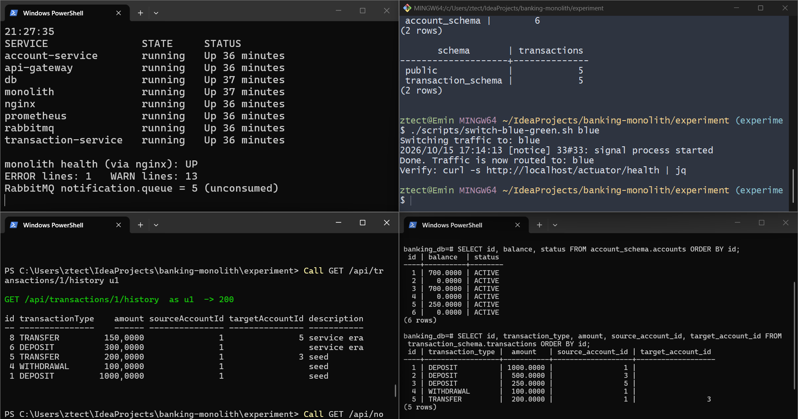 |
| **Partial rollback** (17:30:29): `nginx -T` sends only `/api/accounts` to the gateway; the database at the rollback is the same as in C2a; users still see the service-era account view | 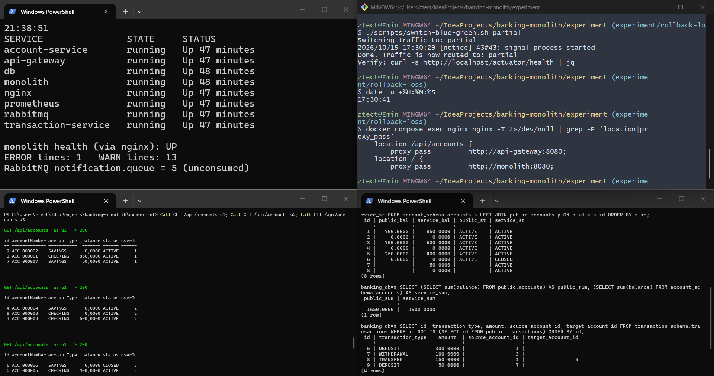 |
| **History and deposit**: the history (monolith) lists 5, 4, 1 while the view shows 850; deposit of 20: 201 with transaction id 6, the view still shows 850 | 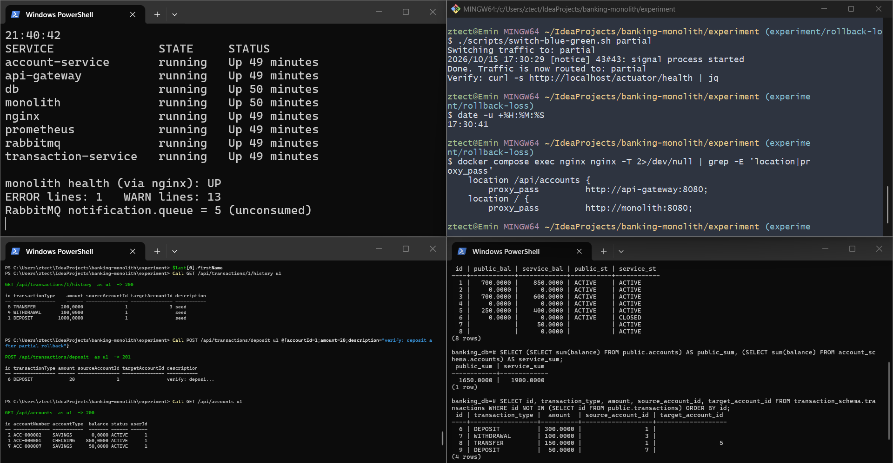 |
| **X, Z, overdraw**: deposit into listed X 404; deposit into `CLOSED` Z 201; u2 withdraws 650 from an account shown at 600: 201, the view still shows 600 | 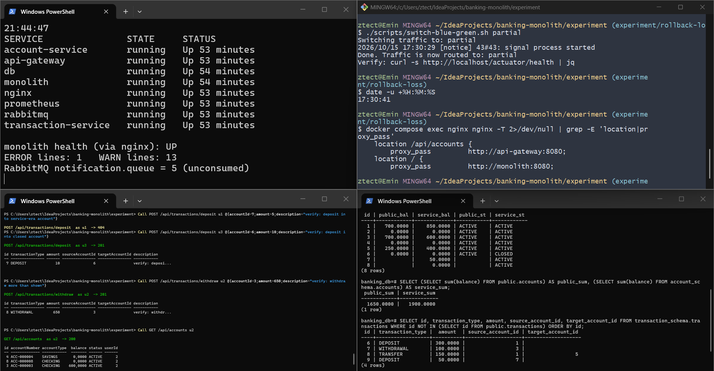 |
| **18 min later** (17:48): health UP, 1 / 13, queue 5; `public` 720 / 50 / 250 / Z 10, `account_schema` 850 / 600 / 400 / Z 0 | 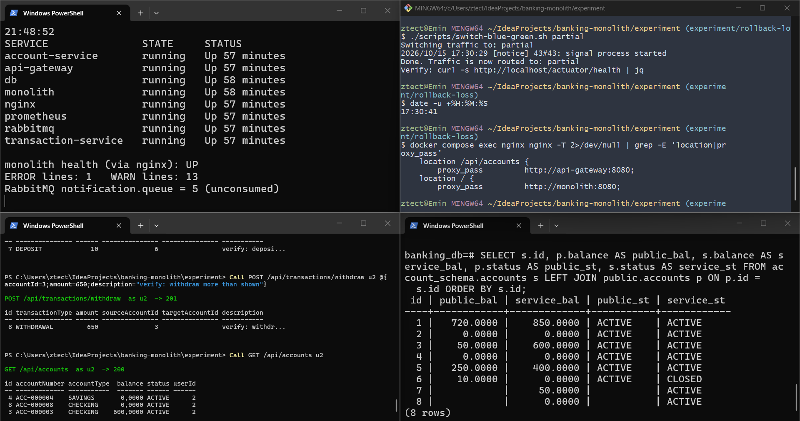 |

Note: `results/C2b/run3/logs-transaction-service.txt` has one line. It is the DEBUG line
of the last service-era notification (19:47:05.066). The rollback was recorded as
19:47:05, and `docker compose logs --since` works in whole seconds, so the line falls in
the window although it was written before the switch. It is not an ERROR or WARN line.

### All conditions

| | C0 | C1a | C1b | C2a | C2b |
|---|---|---|---|---|---|
| Rolled back | everything | everything | everything | everything | `/api/transactions` |
| Runs (manual + automated) | 1 + 3 | 1 + 3 | 1 + 3 | 1 + 3 | 1 + 3 |
| Rollback exit code, health, Prometheus | 0, UP, up | 0, UP, up | 0, UP, up | 0, UP, up | 0, UP, up |
| New ERROR / WARN, 5xx after rollback | 0 | 0 | 0 | 0 | 0 |
| **Service-era writes visible** | **3/3** | – (none made) | **0/3** | **0/3 accounts, 0/2 transactions** | accounts in the view, 0/2 transactions |
| Deposit into the closed account | 400, rejected | – | **201, accepted** | **201, accepted** | **201, accepted** |
| Monolith's next account number | `ACC-000009` | `ACC-000007` | **`ACC-000007`, reused** | **`ACC-000007`, reused** | – (accounts still on the service) |
| Deposit by a service-era id | lands with its owner | – | **lands with another customer** | **lands with another customer** | **404** for an account the user sees |
| Balances | – | unchanged | – | **3 wrong, 400 in total** | **view and money disagree, gap grows** |
| **Withdrawal beyond what the account held / showed** | – | – | – | **+100** | **+50** |
| Transaction ids reused | – | – | – | 3 | 3 |

C0 shows that the switching mechanism loses nothing; C1a shows that the schema
separation and the forward copy lose nothing. In C1b the only difference is writes made
after the separation, and all of them are lost silently. C2a shows the same loss when
money moves through the services: balances go back in time and money can be withdrawn
twice. C2b shows that rolling back only part of the system does not lose rows but leaves
two live copies of the balances that disagree and drift further apart. The signals used to
decide whether a rollback worked (exit code, health, Prometheus, status codes, logs)
measure whether the system is up, not whether its data is complete or consistent.

## Files

```
experiment/
├── docker-compose.yml        one PostgreSQL, monolith, account-service, api-gateway, nginx, prometheus
│                             (C2: + transaction-service, rabbitmq)
├── nginx/                    nginx.monolith.conf, nginx.blue.conf, nginx.partial.conf (C2b)
│                             (nginx.conf is generated)
├── scripts/
│   ├── switch-blue-green.sh  targets: blue, monolith, partial
│   ├── health-loop.ps1       manual runs: top-left pane
│   └── client.ps1            manual runs: Call / Login helpers for the bottom-left pane
├── sql/forward-copy.sql      C1/C2 cut-over copy (+ init-schemas.sql since c1-schema-split)
├── run.sh                    one automated run
├── harness/rollback.py       client and verifier (runs in a python:3.12-slim container)
└── results/
    ├── summary.md            one row per automated run
    ├── C0/ C1a/ C1b/ C2a/ C2b/run1..3/
    │                         http.jsonl (every request and response), summary.json,
    │                         meta.env, logs, DB snapshot, switch script output
    └── manual/
        ├── C0-run1/          logs, db-final.txt, prometheus-targets.json, images/
        ├── C1a-run1/ C1b-run1/  the same, plus nginx-after-rollback.conf,
        │                     prometheus-requests-by-status.json, images/detail/
        └── C2a-run1/ C2b-run1/  README.md (every screenshot described, UTC timeline),
                              db-final.txt, logs, nginx, Prometheus data, mem.txt,
                              images/<phase>/
```

## Reproduce

```bash
git checkout c0-shared-schema && for r in 1 2 3; do experiment/run.sh C0 $r; done
git checkout c1-schema-split  && for c in C1a C1b; do for r in 1 2 3; do experiment/run.sh $c $r; done; done
git checkout d1291a2           && for c in C2a C2b; do for r in 1 2 3; do experiment/run.sh $c $r; done; done
```

This needs Docker with Compose and bash (Git Bash on Windows). The harness runs in a
container, so nothing else is needed on the host. When running manually, rebuild the
images (`docker compose build`) after switching between tags. The C2 stack uses about
1.7 GB of memory (`mem.txt`); run it on a host with some headroom.

## Limits

- One prototype and a synthetic workload. C0/C1 extract only the account module, C2 the
  account and transaction modules; users and notifications always stay in the monolith.
- C2 has no no-write condition; the forward-copy check stands in for it.
- The growing gap in C2b (250 → 870) comes from the manual run only; the automated runs
  record the state at the rollback.
- The experiment can show that the mechanism exists and whether it is silent. It says
  nothing about how common it is.
- It is a reconstruction, not the original thesis run.
